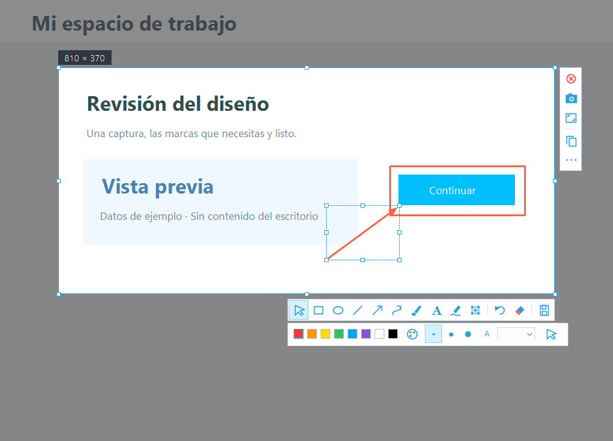

# Trazo

**Captura, anota y comparte.**

Una aplicación portátil y de código abierto para capturar áreas y ventanas en Windows, añadir anotaciones y guardar el resultado.

**[Descargar Trazo para Windows](https://github.com/Racknar0/trazo-capture/releases/download/v0.1.0/Trazo-v0.1.0-windows.zip)** · [Ver releases](https://github.com/Racknar0/trazo-capture/releases/latest)

*Vista del editor con datos de ejemplo.*

## Qué puedes hacer

- **Capturar áreas o ventanas:** selecciona con un clic o arrastra un área; incluye soporte para varios monitores y lupa de precisión.
- **Atajos de captura configurables:** elige las teclas que mejor encajen con tu forma de trabajar.
- **Anotar a tu manera:** flechas, formas, pincel, texto, resaltado, pixelado y desenfoque, con colores y grosores ajustables.
- **Corregir las marcas:** mueve, redimensiona, duplica, elimina y ordena por capas; deshaz o rehace los cambios.
- **Combinar imágenes:** pega desde el portapapeles o añade un archivo a la captura.
- **Dar el acabado final:** giro, escala de grises, borde blanco y sombra, con vista previa antes de exportar.
- **Guardar y continuar:** copia al portapapeles, exporta PNG, JPEG o BMP y conserva proyectos editables `.trazo`.

## Empieza en un minuto

1. Descarga y extrae el ZIP. Abre **Trazo.exe** y conserva su archivo de configuración junto a él.
2. Usa un atajo configurado o el botón **Capturar pantalla**. Haz clic sobre una ventana resaltada o arrastra para seleccionar un área.
3. Usa las barras flotantes para añadir marcas. Pulsa **V** para moverlas o cambiar su tamaño; haz doble clic en un texto para corregirlo.
4. Pulsa **Ctrl + C** para copiar o **Ctrl + S** para guardar.

El botón **···** reúne las opciones de imágenes, capas, proyectos y efectos.

Puedes cambiar las teclas de captura desde **Configurar atajos**, disponible en la ventana principal y en el menú de la bandeja.

## Atajos esenciales

| Atajo | Acción |
| --- | --- |
| **V** | Seleccionar y editar una marca |
| **Ctrl + Z / Ctrl + Y** | Deshacer / rehacer |
| **Ctrl + D / Supr** | Duplicar / eliminar una marca |
| **Ctrl + C / Ctrl + S** | Copiar captura / guardar imagen |
| **Ctrl + Mayús + S** | Guardar proyecto editable |
| **Esc** | Quitar selección o cancelar |

Mientras escribes texto, **Enter** confirma la anotación y **Mayús + Enter** añade un salto de línea.

## Requisitos y uso diario

- Windows con **.NET Framework 4.8**. No necesita instalador.
- Puedes iniciar capturas desde los atajos que configures o desde el botón de la ventana principal.
- Al cerrar la ventana, Trazo permanece junto al reloj. Para salir, haz clic derecho en su icono y elige **Cerrar Trazo**.
- Antes de abrir una versión nueva, cierra la anterior desde la bandeja.

Los proyectos `.trazo` conservan el fondo y las marcas para seguir editando. Para compartir una captura con las anotaciones aplicadas, exporta una imagen.

## Participa

¿Encontraste un fallo o tienes una idea? [Abre un issue](https://github.com/Racknar0/trazo-capture/issues). Para contribuir al código, consulta [CONTRIBUTING.md](CONTRIBUTING.md).

## Licencia

[MIT](LICENSE) · Copyright © 2026 Racknar0.
