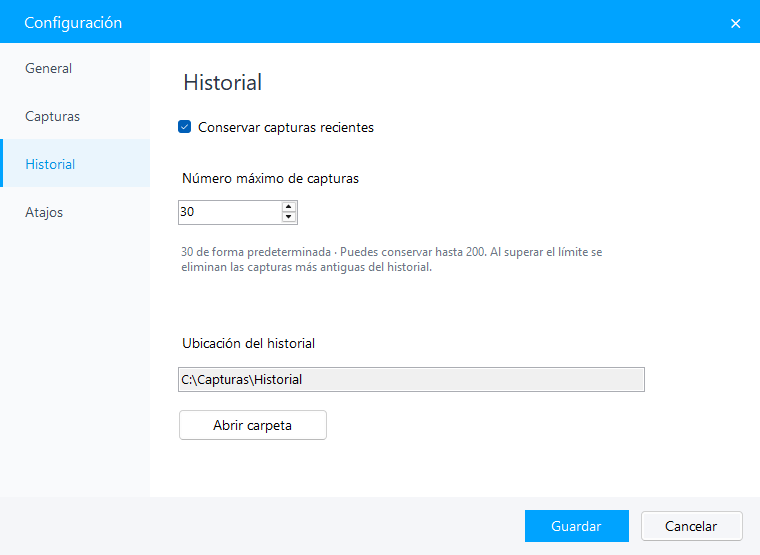

# Trazo

**Captura, anota y comparte.**

Una aplicación de código abierto para capturar áreas y ventanas en Windows, editar imágenes y organizar tus capturas recientes.

**[Descargar instalador para Windows](https://github.com/Racknar0/trazo-capture/releases/download/v0.2.0/Trazo-v0.2.0-setup.exe)** · [Versión portátil](https://github.com/Racknar0/trazo-capture/releases/download/v0.2.0/Trazo-v0.2.0-windows.zip) · [Ver releases](https://github.com/Racknar0/trazo-capture/releases/latest)

*Capturas de ejemplo en la ventana principal.*

## Qué puedes hacer

- **Capturar áreas o ventanas:** selecciona con un clic o arrastra un área; incluye varios monitores y lupa de precisión.
- **Organizar tus capturas:** una ventana principal con miniaturas, vista previa y acciones para copiar, editar, guardar o eliminar.
- **Conservar un historial:** guarda las últimas **30 capturas** por defecto. Puedes desactivarlo o ajustar el límite entre **1 y 200**.
- **Elegir tus atajos:** añade, cambia o quita las teclas y combinaciones que inician una captura.
- **Anotar a tu manera:** flechas, formas, pincel, texto, resaltado, pixelado y desenfoque, con colores y grosores ajustables.
- **Corregir y combinar:** mueve, redimensiona, duplica y ordena marcas por capas; pega imágenes y deshaz o rehace cambios.
- **Dar el acabado final:** giro, escala de grises, borde blanco y sombra, con vista previa antes de exportar.
- **Guardar y continuar:** copia al portapapeles, exporta PNG, JPEG o BMP y conserva proyectos editables `.trazo`.
- **Adaptar la aplicación:** configura el inicio con Windows, el comportamiento al cerrar, los atajos, el historial y la carpeta de guardado.

## Instalar y empezar

1. Descarga y ejecuta **Trazo-v0.2.0-setup.exe**. El asistente permite elegir la carpeta y los accesos directos.
2. Abre **Trazo** desde el menú Inicio o el escritorio.
3. Usa un atajo configurado o el botón **Capturar pantalla**. Haz clic sobre una ventana resaltada o arrastra para seleccionar un área.
4. Añade marcas con las barras flotantes y termina con **Ctrl + C** para copiar o **Ctrl + S** para guardar.

Las capturas terminadas aparecen en la ventana principal. Las canceladas no se añaden al historial. El límite conserva las más recientes y elimina automáticamente las copias antiguas del historial; tus archivos exportados se mantienen en la carpeta que elegiste.

El botón **···** del editor reúne las opciones de imágenes, capas, proyectos y efectos. Pulsa **V** para mover una marca o cambiar su tamaño; haz doble clic en un texto para corregirlo.

## Configuración

Abre **Configuración** en la ventana principal o desde el icono junto al reloj:

- **General:** iniciar con Windows y elegir qué ocurre al cerrar la ventana.
- **Capturas:** carpeta, formato de imagen y visibilidad del panel principal durante la selección.
- **Historial:** activar el guardado y elegir cuántas capturas conservar, hasta 200.
- **Atajos:** gestionar las teclas y combinaciones de captura.

La primera vez que cierras la ventana puedes elegir **quedar en la bandeja**, **cerrar Trazo** o **cancelar**, y recordar la elección. Para salir completamente desde la bandeja, elige **Cerrar Trazo**.

## Atajos del editor

| Atajo | Acción |
| --- | --- |
| **V** | Seleccionar y editar una marca |
| **Ctrl + Z / Ctrl + Y** | Deshacer / rehacer |
| **Ctrl + D / Supr** | Duplicar / eliminar una marca |
| **Ctrl + C / Ctrl + S** | Copiar captura / guardar imagen |
| **Ctrl + Mayús + S** | Guardar proyecto editable |
| **Esc** | Quitar selección o cancelar |

Mientras escribes texto, **Enter** confirma la anotación y **Mayús + Enter** añade un salto de línea. Los proyectos `.trazo` conservan el fondo y las marcas; para compartir el resultado final, exporta una imagen.

## Requisitos y desinstalación

- Windows con **.NET Framework 4.8**.
- El instalador es para tu usuario y no necesita permisos de administrador.
- También puedes usar el ZIP portátil sin instalar.
- Puedes desinstalar Trazo desde **Configuración de Windows → Aplicaciones**. Las capturas y preferencias personales se conservan.

## Participa

¿Encontraste un fallo o tienes una idea? [Abre un issue](https://github.com/Racknar0/trazo-capture/issues). Para contribuir al código, consulta [CONTRIBUTING.md](CONTRIBUTING.md).

## Licencia

[MIT](LICENSE) · Copyright © 2026 Racknar0.
